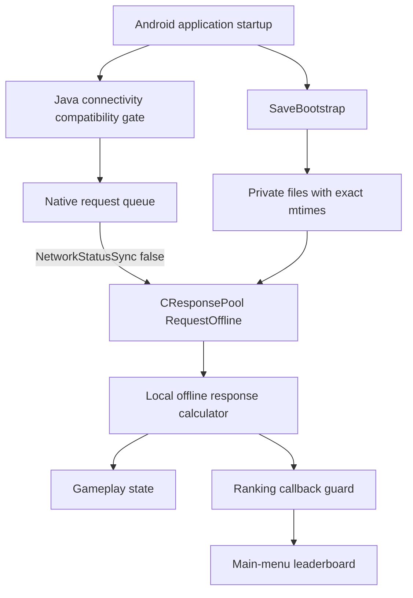

# Architecture

## Goal

Birzzle Fever 1.1.2 depended on a retired Hangame service while also containing a substantial local response calculator. The project makes the existing local path deterministic, repairs persistence hazards discovered during testing, and provides a clean first-install data bootstrap.

V25 changes three layers. Each layer has a separate invariant; treating them as one “offline flag” caused several rejected builds.



## Identity

The original save is bound to the application-level identifier:

```text
3c8bb7308c3fcb60c439224bd595c794d8f31501
```

The identifier selects hashed filenames and participates in the local backend's identity model. It is not Android's Linux package UID. Earlier Xposed testing replaced `GetUniqueDeviceID()` at runtime; V3 and later return the historical identifier inside the native game library. A fresh installation therefore uses its naturally assigned Android package UID while retaining save compatibility.

## Offline request routing

Startup contains two connectivity decisions:

1. Java methods gate initialization based on Android reachability.
2. `Enfeel::CRequestQueue::NetworkStatusSync()` chooses the native queue route.

V24 keeps the Java gate satisfied but makes the native method return false. False selects `CResponsePool::RequestOffline`; it does not fabricate a working server connection. Obsolete GCM registration is skipped and the package's GCM receiver/service declarations are removed so delayed retries cannot reinitialize the game.

## Save bootstrap

The package bootstrap installs a sanitized 26-file seed only when the expected private state is absent. Required properties:

- paths are constrained to the app-private destination;
- existing profiles are not overwritten;
- a completion marker separates complete from partial extraction;
- Unix mtimes come from ZIP extended timestamp field `0x5455`, avoiding DOS ZIP's two-second resolution loss;
- Android assigns ownership naturally during first-install extraction.

The seed archive itself is not committed. Its content contract and hashes remain documented in [MINIMAL_PUBLIC_SAVE.md](../MINIMAL_PUBLIC_SAVE.md) and the V25 release-evidence manifest.

## Response-pool persistence

The local backend stores an encrypted index and numbered request records. Domain state is reconstructed by replaying those records. A transient empty index read previously looked like a new pool and allowed the index to collapse to request zero, regressing pocket, inventory, quest, mission, and ranking state together.

The accepted lineage evolved as follows:

- V20: retain an in-process high-water mark and refuse to treat a transient empty read as a fresh mature pool;
- V21: persistently classify pool maturity and validate referenced records;
- V22: recover safely on the first process read and tolerate cryptographically valid timestamp skew;
- V23: write the numbered request durably before atomically replacing the index;
- V24/V25: retain this hardening while always selecting the local response route.

The implementation prefers a controlled wait over destructive reinitialization when a mature index is corrupt, missing, or references a missing record. This protects data; it does not silently invent missing progression.

## Ranking and scene transitions

The original data could deliver duplicate or badly timed `SCORE.RANKING` callbacks. Early patches alternated between crashes and loading-dialog softlocks because startup, normal menu refresh, power-up cancellation, mid-game quit, and completed-game return do not share identical call sequences.

The accepted gameplay library keeps one ranking request in flight, closes the generation gate until the current UI consumes the response, and rearms at the common return-to-main-menu transition. Loading-dialog cleanup is retained for both startup and return paths.

The V25 seed also preserves the offline ranking calculator's two-slot template contract:

- slot 0: historical identity with score `-1`;
- slot 1: historical identity with score `0`.

The calculator updates slot 1 from replayed `POCKET.SET.tropy` values. Distinct sentinel scores avoid the historical equal-entry crash while preserving the UI's single `My Score` identity.

## Unlimited play

The historical life timer no longer replenishes reliably. V15 retains the normal life display and persistence but bypasses heart deduction at the safe game-start boundary. This allows a game to start when the displayed count reaches zero without granting currency or changing unrelated progression.

## Trust boundaries

- Patch scripts verify exact source hashes and expected bytes before mutation.
- Device harnesses assume an authorized rooted test device and can replace app data.
- Signing keys and passwords never belong in the repository.
- Original/decompiled game material remains outside source control.
- Published claims are limited to the devices and paths actually exercised.
